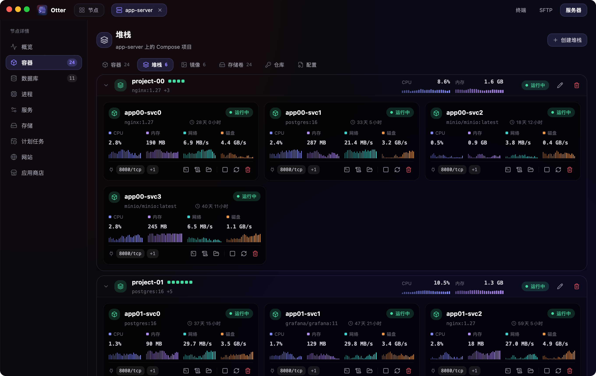
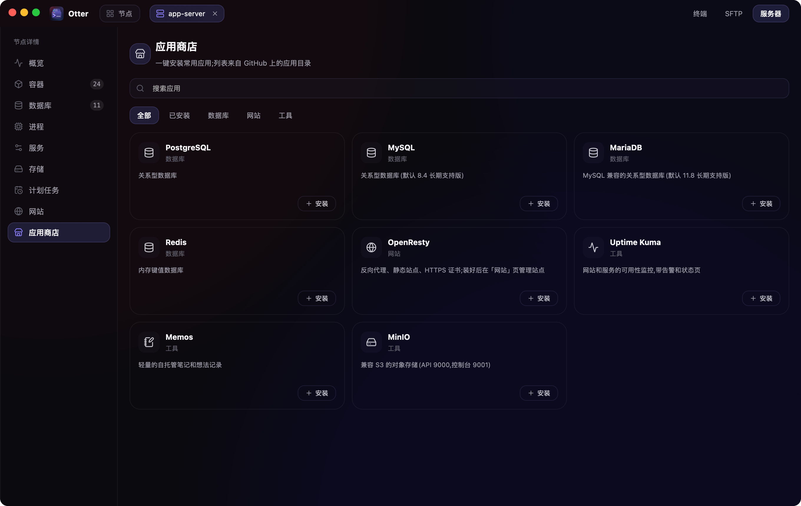
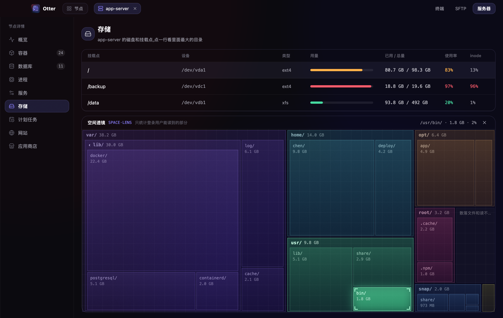
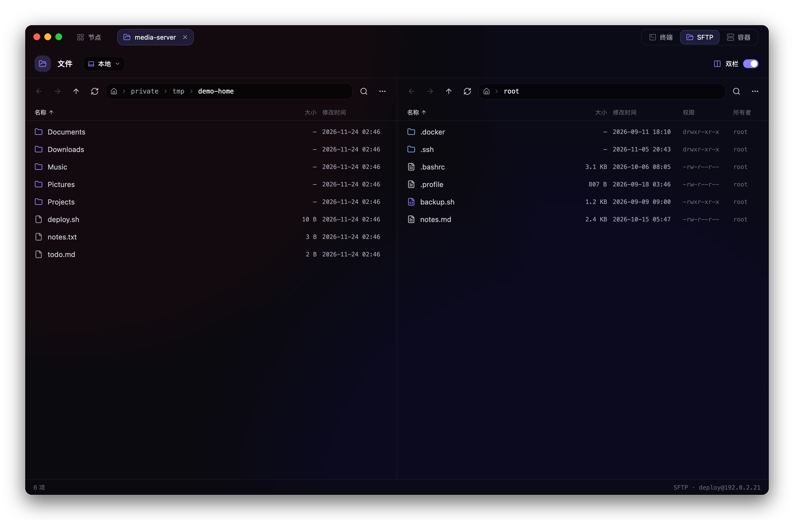

# Otter

[中文](README.md) · English

A native SSH client: terminal, files (SFTP) and server management (Docker, databases, websites, app store) in one window, with nothing installed on the server. Built in Rust on [GPUI](https://www.gpui.rs) and [russh](https://github.com/Eugeny/russh).

## Screenshots

<table>
  <tr>
    <td width="50%" valign="top">
      <br>
      <b>Stacks</b><br>Live CPU, memory, network and disk for Compose stacks and containers; start, stop, restart, delete, and edit and deploy compose files.
    </td>
    <td width="50%" valign="top">
      <br>
      <b>App store</b><br>One-click install of PostgreSQL, MySQL, Redis, OpenResty and more; installed apps are checked for upgrades silently.
    </td>
  </tr>
  <tr>
    <td width="50%" valign="top">
      <br>
      <b>Storage & space lens</b><br>Disk and mount usage; a treemap shows which directories take the space. Click to expand, double-click to zoom.
    </td>
    <td width="50%" valign="top">
      <br>
      <b>Files (SFTP)</b><br>Browse, preview and drag-and-drop upload; optional dual panes for local vs. server, and files inside containers.
    </td>
  </tr>
  <tr>
    <td width="50%" valign="top">
      <br>
      <b>Agent takeover approval</b><br>An AI agent must ask before taking over a terminal: allow once, for 24 hours or always, and stop it any time.
    </td>
    <td width="50%"></td>
  </tr>
</table>

## Highlights

- **Native and small**: a Rust app drawing straight on the GPU, with no Electron or browser engine bundled. The macOS download is about 21 MB.
- **Fast**: launches in about 0.25 s (MacBook Pro, Apple M5 Pro), and long scrolling lists stay smooth.
- **Nothing installed on servers**: everything goes over SSH. No agent, daemon or web panel on the server, and no extra management port exposed.
- **Safe by default**: passwords and key passphrases are encrypted on disk, with the master key in the system keychain. An agent can never take over a terminal without your approval.

## Features

- **Nodes & groups**: organize servers, search, import from CSV or `~/.ssh/config`.
- **SSH terminal**: password, private key or SSH agent auth.
- **Files (SFTP)**: browse, preview, drag-and-drop upload, create folders, delete; also inside containers.
- **Docker**: stacks, containers, images, volumes and registries; start, stop, restart, delete, edit and deploy compose files, delete stacks.
- **App store**: one-click install of PostgreSQL, MySQL, MariaDB, Redis, OpenResty and more, with one install / upgrade / uninstall flow. The catalog refreshes daily from the repository, and installed apps are checked for upgrades silently.
- **Databases**: manage databases and users, view and change common parameters and config files, copy connection info in one click.
- **Websites**: manage OpenResty sites (reverse proxy, static, redirect), HTTPS certificates (issue and renew), performance and security settings.
- **Server ops**: processes, services, cron jobs, storage (space lens).
- **Auto update**: checks GitHub Releases and updates in place from the header.
- **Agent interface**: let an AI agent read your nodes and, with your approval, take over a terminal session.

## Install

Download from the [Releases](../../releases) page:

- **macOS**: `.dmg`. The app is not notarized, so macOS may say it "is damaged and can't be opened. You should move it to the Trash". It is not damaged: after dragging it to Applications, run `xattr -cr /Applications/Otter.app` once, then open it.
- **Windows**: `-setup.exe`. Installs per user, no admin rights needed.
- **Linux**: `.tar.gz` containing `otter-gui` and `otter`.

## Usage

Open Otter, add a node (or import), and click it to open its terminal, files (SFTP) and server management (containers, databases, websites, app store and more).

### Agents

Reading nodes and sessions needs no approval. Taking over a terminal always asks you first, shows an overlay while the agent types, and can be stopped with one click. Granted agents are listed on the **Trust** page, where you can revoke them.

Command line:

```bash
otter nodes                          # server nodes (JSON)
otter sessions                       # open terminal sessions
otter takeover --reason "check disk" --agent my-agent
otter run "df -h"                    # prints only the new output
otter release                        # hand the session back
otter --help                         # all commands
```

MCP (stdio), e.g. Claude Code:

```bash
claude mcp add otter -- otter mcp
```

## License

MIT
