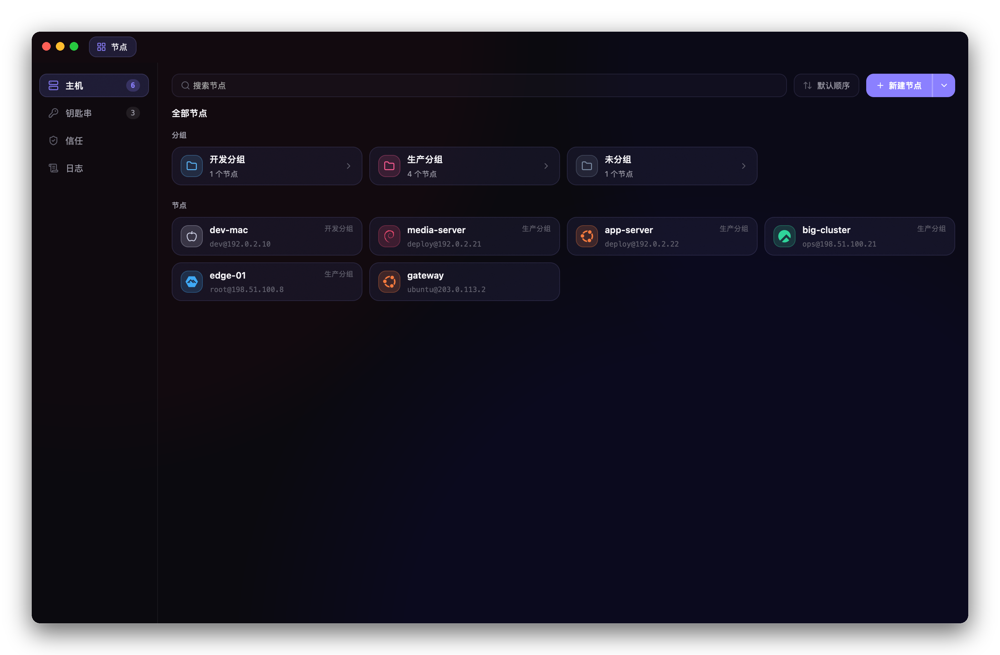
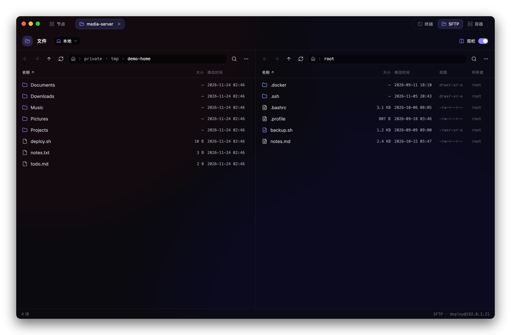
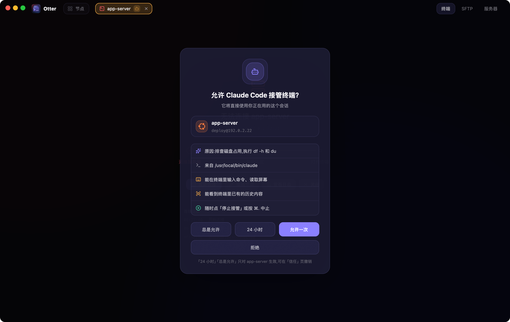

# Otter

中文 · [English](README.en.md)

原生 SSH 客户端:终端和文件(SFTP)放在一个窗口里。基于 [GPUI](https://www.gpui.rs) 和 [russh](https://github.com/Eugeny/russh),Rust 编写。

## 截图







## 特点

- **原生、体积小**:Rust 编写,直接用 GPU 渲染,没有打包 Electron 或浏览器内核。macOS 安装包约 16 MB。
- **启动快**:启动约 0.25 秒(MacBook Pro,Apple M5 Pro),长列表滚动也流畅。
- **默认安全**:密码和私钥口令加密存储,主密钥放在系统钥匙串;agent 没有你的同意绝不能接管终端。

## 功能

- **节点与分组**:服务器分组、搜索,支持从 CSV 或 `~/.ssh/config` 导入。
- **SSH 终端**:密码、私钥、SSH Agent 认证。
- **文件(SFTP)**:浏览、预览、拖入上传、新建文件夹、删除;容器内的文件也能看。
- **Docker**(开发中):堆栈、容器、镜像、存储卷;启动、停止、重启、删除。
- **自动更新**:通过 GitHub Release 检查新版本,在标题栏一键更新。
- **Agent 接口**:让 AI agent 读取节点信息,并在你同意后接管终端会话。

## 安装

在 [Releases](../../releases) 页面下载:

- **macOS**:`.dmg`。应用没有公证,macOS 可能提示"已损坏,无法打开,您应该将它移到废纸篓"。其实没有损坏:拖进「应用程序」后执行一次 `xattr -cr /Applications/Otter.app`,再打开即可。
- **Windows**:`-setup.exe`。装到当前用户目录,不需要管理员权限。
- **Linux**:`.tar.gz`,内含 `otter-gui` 和 `otter`。

## 使用

打开 Otter,添加节点(或导入),点节点卡片即可打开它的终端、文件和 Docker 标签。

### Agent

读取节点和会话不需要确认。接管终端每次都会先问你,接管期间界面有遮罩提示,随时可以一键停止。已授权的 agent 在「信任」页里,可以撤销。

命令行:

```bash
otter nodes                          # 服务器节点(JSON)
otter sessions                       # 已打开的终端会话
otter takeover --reason "查看磁盘" --agent my-agent
otter run "df -h"                    # 只返回这条命令的新输出
otter release                        # 把会话还给用户
otter --help                         # 全部命令
```

MCP(stdio),例如 Claude Code:

```bash
claude mcp add otter -- otter mcp
```

## 许可证

MIT
