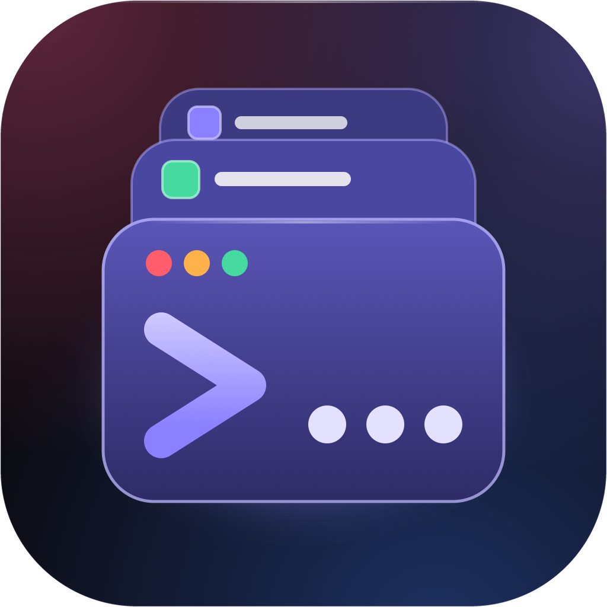

<div align="center">



# Otter

**Manage your servers over plain SSH: terminal and files in one native window. Nothing to install on the server.**

English · [简体中文](README.zh-CN.md)

</div>

## Features

- **Nodes & groups**: organize servers, search, import from CSV or `~/.ssh/config`.
- **SSH terminal**: password, private key or SSH agent auth.
- **Files (SFTP)**: browse, preview, drag-and-drop upload, create folders, delete; also inside containers.
- **Docker** (in development): stacks, containers, images and volumes; start, stop, restart, delete.
- **Agent interface**: let an AI agent read your nodes and, with your approval, take over a terminal session.

## Tech stack

Rust, [GPUI](https://www.gpui.rs) (GPU-rendered native UI), [russh](https://github.com/Eugeny/russh) (SSH / SFTP), tokio, SQLite.

## Install

Download from the [Releases](../../releases) page:

- **macOS**: `.dmg`. Not notarized: right-click → Open on first launch.
- **Windows**: `-setup.exe`. Installs per user, no admin rights needed.
- **Linux**: `.tar.gz` containing `otter-gui` and `otter`.

## Usage

Open Otter, add a node (or import), and click it to open its terminal, files and Docker tabs.

### Agents

Reading nodes and sessions needs no approval. Taking over a terminal always asks you first, shows an overlay while the agent types, and can be stopped with one click. Granted agents are listed on the **Trust** page, where you can revoke them.

Command line:

```bash
otter nodes                          # server nodes (JSON)
otter sessions                       # open terminal sessions
otter takeover --reason "check disk" --agent my-agent
otter run "df -h"                    # prints only the new output
otter release                        # hand the session back
otter --help                         # all commands
```

MCP (stdio), e.g. Claude Code:

```bash
claude mcp add otter -- otter mcp
```
